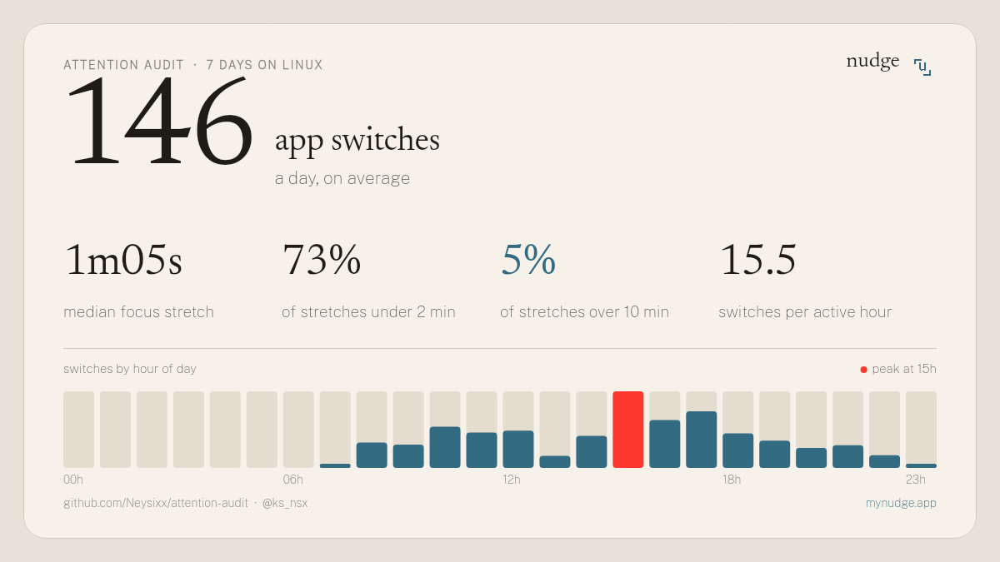

# attention audit

How many times a day do you actually switch apps on your computer? Run this for a week and find out.

Supports **macOS** and **Linux** (GNOME Wayland, X11, Sway, Hyprland).



## Install

Open Terminal, paste this, press enter:

```bash
curl -fsSL https://raw.githubusercontent.com/Neysixx/attention-audit/main/install.sh | bash
```

That's it. No sudo, no configuration required.

- The audit runs quietly in the background and restarts at login (**LaunchAgent** on macOS, **systemd --user** on Linux).
- After 7 days, a prompt offers your card. One click: it opens, with a prefilled post if you want to share it.
- Want it earlier? Open **Attention Card** from your application menu / Spotlight, or run `~/.attention-audit/card.sh`.

Uninstall any time with a single command:

```bash
~/.attention-audit/install.sh uninstall
```

## System Requirements & How It Works

| OS | Background Service | Active App & Idle Detection | Card Renderer | Dependencies |
|---|---|---|---|---|
| **macOS** | `LaunchAgent` via `launchctl` | `lsappinfo` + `ioreg` | AppleScript / JXA (`AppKit`) | **None** (all macOS built-ins) |
| **Linux** | `systemd --user` | • GNOME Wayland: Mutter D-Bus + bundled focus probe<br>• Hyprland / Sway: compositor IPC<br>• X11: `xprintidle` + `xprop` | `@napi-rs/canvas` | [**Bun**](https://bun.sh) (`curl -fsSL https://bun.sh/install \| bash`), `zenity` (optional for GUI prompts) |

## Privacy & Transparency

Read the scripts before you run them, they are intentionally short and straightforward.

- **Only the frontmost app name** is recorded (`Code`, `Firefox`, `Slack`, etc.). **No window titles, no URLs, no keystrokes, no screen captures.**
- **No elevated permissions needed**:
  - On macOS, it reads the front app via LaunchServices (`lsappinfo`), which requires no Accessibility permission.
  - On Linux (GNOME Wayland), it uses a lightweight user-space D-Bus probe and Mutter's idle monitor.
- **100% offline**: Everything is stored locally in `~/.attention-audit/data/` as plain CSV files (`audit_YYYY-MM-DD.csv`). No data is ever sent across the network.
- **The card never shows app names**: It only displays aggregate focus metrics (median focus stretch, switches per day/hour, etc.), making it completely safe to share.
- **Nothing is ever posted automatically**: The share button only opens a prefilled draft in your web browser.

## Repository Structure

| File | What it does |
|---|---|
| `audit.sh` | Unified logger: every 30s, records the frontmost app. 5 min without mouse/keyboard input is logged as `idle`. |
| `card.sh` | Orchestrator: generates the card image, opens it, and prepares a draft post. |
| `card-macos.js` | Generates the card on macOS with zero external dependencies (JXA + AppKit). |
| `card-linux.js` | Generates the card on Linux using Bun and `@napi-rs/canvas`. |
| `install.sh` | Universal installer: configures background autostart (LaunchAgent / systemd) and adds the launcher app. |
| `assets/` | Nudge icon, GNOME probe extension, and the card typography fonts (Newsreader & Public Sans). |

Prefer running it by hand? Clone the repo, run `./audit.sh` in a terminal tab, and run `./card.sh` whenever you want your card (`./card.sh --no-share` to only print the text report in terminal).

## What the numbers mean

- **app switches a day**: how often the frontmost app changed while you were active.
- **focus stretch**: an uninterrupted run on a single app. The median tells you how long you typically stay before switching.
- **under 2 min / over 10 min**: share of stretches that were very short vs. long enough to get real work done.
- **switches by hour**: when your day gets most fragmented. The red bar marks your peak hour.

App-level tracking is a rough proxy: switching from your editor to documentation for the same task counts as a switch. It's a mirror, not a verdict.

If you post your card, tag [@ks_nsx](https://x.com/ks_nsx): I repost the most interesting ones and look forward to comparing attention rhythms across Mac and Linux setups.

## Why this exists

Built around [Nudge](https://mynudge.app/?utm_source=attention-audit&utm_medium=readme#waitlist), a focus app designed to gently bring you back to deep work after distractions without harsh blocking. This audit is an open-source tool to measure your real attention habits first.

## License

MIT. Bundled fonts in `assets/fonts` ([Newsreader](https://github.com/productiontype/Newsreader), [Public Sans](https://github.com/uswds/public-sans)) are under the SIL Open Font License, see the OFL files in `assets/fonts/`.
